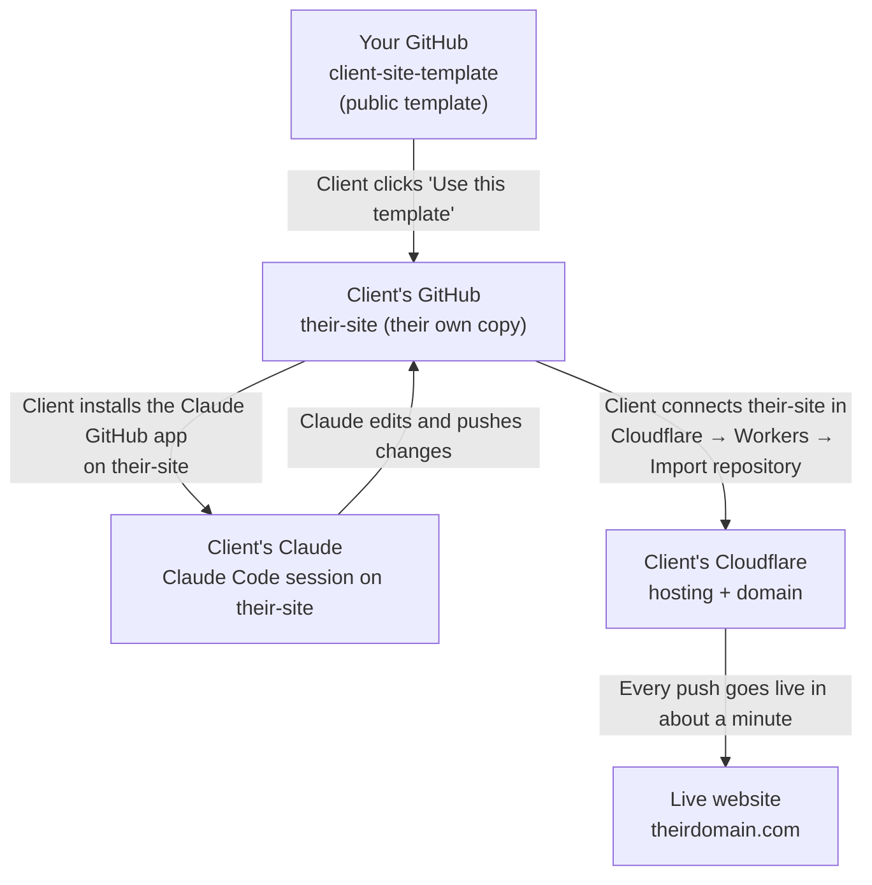

# Setting up a client website (on a Zoom call)

**The principle: the client owns everything from minute one.** Their website lives in their own GitHub account, is hosted on their own Cloudflare account, and is edited with their own Claude account. Nothing has to be transferred later, and you never hold their passwords.

Your template is a public "starter" repository on your GitHub. The client clicks **Use this template**, and GitHub makes them their own copy. Your original stays untouched and can be reused for every client.

## Before the call (client does this, about 15 minutes)

| # | Account | Notes |
|---|---|---|
| 1 | GitHub: github.com/signup | Free. Their email, a password and a username. |
| 2 | Cloudflare: dash.cloudflare.com/sign-up | Free plan |
| 3 | Claude: claude.ai | A paid plan that includes Claude Code (Pro or above) |
| 4 | Intake answers and photos | See `INTAKE.md` |

## On the call (the client shares their screen and clicks; you guide)

| # | Step | Where | Time |
|---|---|---|---|
| 1 | **Make their copy.** Open your template link, click **Use this template → Create a new repository**, name it (e.g. `their-name-site`), choose **Private** → **Create repository** | github.com/kariboo333/client-site-template | 2 min |
| 2 | **Give Claude access.** Install the Claude GitHub app and choose **Only select repositories → their-name-site** | github.com/apps/claude → Install | 3 min |
| 3 | **Start Claude.** Open Claude Code → New session, and choose **their-name-site** as the repository. If it isn't listed, type: "Connect the GitHub repository their-username/their-name-site". | claude.ai/code | 2 min |
| 4 | **Fill the site.** Paste the intake answers and attach the photos, then say: "Fill in this website from my intake answers, following CLAUDE.md. Replace every [[placeholder]]." Review together and ask for changes. | Claude Code | 30–45 min |
| 5 | **Put it online.** Cloudflare → **Workers & Pages → Create → Import a repository** → connect GitHub → choose their-name-site → **Deploy**. This gives a preview address ending `.workers.dev`. | dash.cloudflare.com | 5 min |
| 6 | **Connect their domain.** Add the domain to Cloudflare (free plan), then change the nameservers at their registrar (Wix, GoDaddy…). Check the email (MX) records are kept before switching. Then Workers project → **Settings → Domains & Routes → Add custom domain** for the domain and www. | Cloudflare + registrar | 10 min, plus waiting time |
| 7 | **Teach the editing loop.** The client asks for one small change themselves (e.g. "change my headline to…"), then watches it go live | Claude Code | 5 min |
| 8 | **Hand over** `EDITING.md` | — | — |

If the domain is still waiting to switch over, end the call after step 5. The `.workers.dev` preview works immediately, and step 6 can finish by email.

## Alternative: build first, hand over after

Use this when you want to build before involving the client.

1. Click **Use this template** on your own account to create `client-name-site`, and build it with Claude.
2. When it's ready: **Settings → General → Danger zone → Transfer ownership** → enter the client's GitHub username. They accept by email.
3. On the call, the client does steps 2, 3, 5 and 6 above on their own accounts.

## After launch

| Item | Where |
|---|---|
| Submit `sitemap.xml` | Google Search Console (client's Google account) |
| Visitor numbers | Cloudflare → Analytics & Logs → Web Analytics |
| Contact form messages | Formspree (free) → new form → paste the URL into `index.html` |
| Payments | Stripe → Payment Links, one per offer, added to `offers.html` |
| Ongoing help | Your Support Blocks: the client adds you as a collaborator (repository Settings → Collaborators) so you can edit too |
